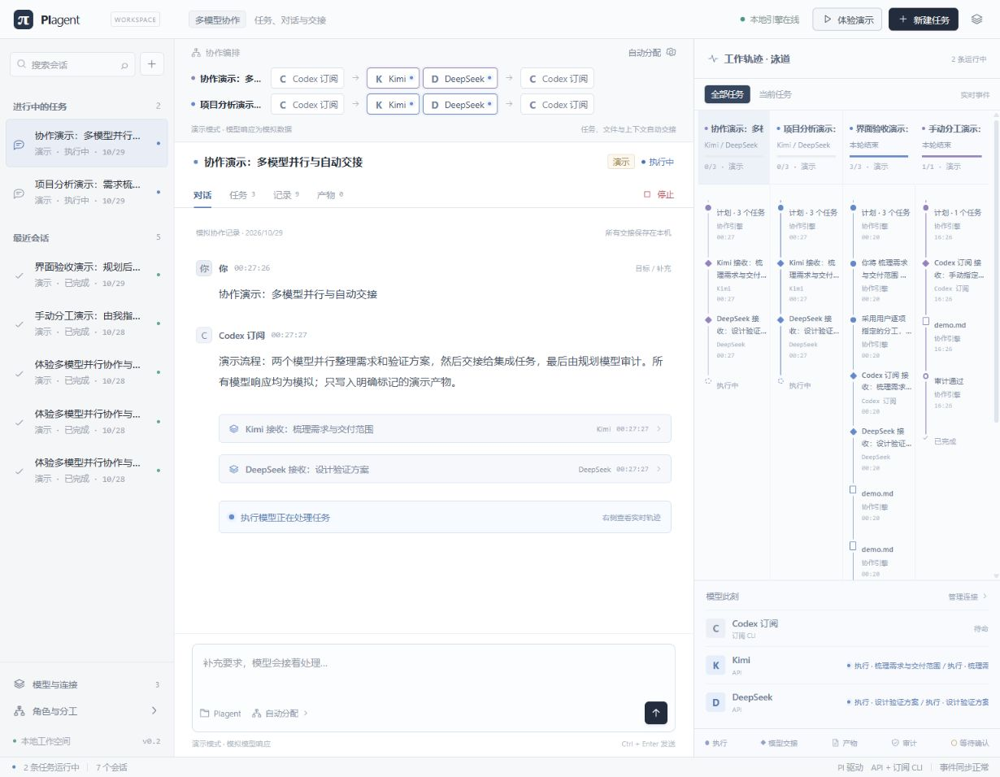

# PIMutiAgent

多订阅、多模型共同工作：一个目标，由你选择谁规划、谁执行、谁审计，模型之间自动交接任务、上下文与产物。

基于 Pi 的本地多模型协作工作台。支持 API、Coding / Token Plan 和官方账号 CLI，自由配置模型角色、执行池、固定规则与人工分工；提供对话、并行任务泳道、审计确认和会话归档。



## 快速开始：双击启动

**前提：安装 [Node.js 24 或更高版本](https://nodejs.org/)，包含 npm。** 首次启动需要联网下载依赖。可以先体验演示，无需 API Key 或订阅账号。

### Windows

1. 在本仓库点击 **Code → Download ZIP**，解压到本机文件夹；或使用下面的 Git 命令下载。
2. 双击解压目录里的 **`start.bat`**。
3. 首次自动执行 `npm ci` 安装锁定版本的依赖，然后启动服务并打开浏览器。
4. 页面默认位于 **http://127.0.0.1:4317**。点击 **“体验演示”** 查看完整模拟协作流程。

后续继续双击 `start.bat`。依赖未变化时跳过安装；检测到同端口已有 PIagent 服务时，直接打开已有页面。**保持启动窗口开启，按 Ctrl+C 停止服务。**

首次配置或启动失败时，窗口会保留错误提示。没有自动安装 Node.js、额外模型 CLI，也不会替你登录厂商账号。

### macOS / Linux

安装 Node.js 24+ 后，在项目目录执行：

```sh
sh start.sh
```

通用命令方式：

```sh
git clone https://github.com/HARRISON1014/PIMutiAgent.git
cd PIMutiAgent
npm run launch
```

服务器或不希望自动打开浏览器时：

```sh
node scripts/launch.js --no-open
```

也可手动执行 `npm ci`、`npm start`；手动 `npm start` 不会自动安装依赖或打开浏览器。

## 首次接入真实模型

模拟演示不会调用真实模型。正式使用前，在页面左下角 **“模型与连接”** 中配置自己的连接：

| 来源 | 首次需要做什么 |
| --- | --- |
| API | 添加厂商预设，填写自己的 API Key 和真实模型 ID，确认 Base URL；保存后可读取模型列表或进行推理测试。 |
| Coding / Token Plan | 选择对应套餐预设，使用该套餐自己的密钥、端点和模型权限。 |
| 订阅 / 账号 CLI | 自行安装对应官方 CLI 并在本机完成账号登录；添加 CLI 连接，检测安装与登录状态，再验证推理。 |

例如，Codex 使用官方客户端的 ChatGPT 登录（`codex login`），Claude、Gemini、Copilot、Qwen、Kimi 使用各自官方 CLI 的账号认证。安装及认证资料见 [连接适配说明](docs/adapters.md#官方资料)。CLI 可执行文件不在 PATH 中时，在连接设置中填写其可执行文件 / JS 入口的绝对路径。推理测试会消耗对应账号或 API 额度。

然后点击 **“设置本轮分工”**，分别选择规划、审计、风险判断和执行模型，选择自动规划、先规划再指定、或完全手动分工，发送目标即可开始。默认 Codex / Kimi / DeepSeek 连接仅作为空配置示例，不限制角色或厂商。

**下载项目不会携带任何人的 API Key、订阅登录或任务历史。** API Key 由你在本机配置；订阅登录由对应官方 CLI 管理。网页会员不能自动视为可程序调用的订阅额度。

## 本地配置、更新与排错

- 常规配置直接使用页面，保存到 `.piagent/`。API Key 仅保存在本机 `.piagent/secrets.json`，或可从自己的 `.env` 读取；仓库只提供空值的 `.env.example`。
- 修改端口：复制 `.env.example` 为 `.env`，将 `PORT=4317` 改为可用端口后重新启动；浏览器会打开对应地址。
- 更新 Git 下载的项目：先停止服务，执行 `git pull --ff-only`，再双击 `start.bat` / 执行 `sh start.sh`。锁文件变化时自动重新安装依赖；`.piagent/` 和 `.env` 保留在本机。
- 提示找不到 Node / npm：安装带 npm 的 Node.js 24+，重新打开启动窗口。
- 依赖下载失败或长时间没有进展：检查 npm 的网络 / 代理、Node 与 npm 版本，可运行 `npm cache verify` 后重试，或手动执行 `npm ci --no-audit --no-fund` 查看错误。启动器每 30 秒提示等待状态，10 分钟超时后停止本次安装；不会自动清空全局缓存或修改代理 / npm 配置。
- 提示端口占用：关闭占用该端口的程序，或在 `.env` 中换一个端口。
- 模型无法调用：检查真实模型 ID、密钥、套餐端点及官方 CLI 登录；“已安装 / 已登录”不等于该模型推理已验证。
- 运行记录、日志和产物在 `.piagent/`。反馈问题时先移除密钥、认证信息及私人项目内容。

发布与隐私检查见 [安全与本地数据说明](docs/security.md)。

底层使用 Pi 官方 `@earendil-works/pi-agent-core` 与 `@earendil-works/pi-ai` 1.4.0；项目来源为 [earendil-works/pi](https://github.com/earendil-works/pi)。

## 三种分工方式

在页面的“设置本轮分工”中选择：

| 方式 | 如何控制任务 |
| --- | --- |
| 规划模型自动分配 | 你选规划模型、执行池和默认执行模型，规划模型在池中分配任务。固定规则由调度器强制执行。 |
| 先规划，再由我逐项指定 | 规划完成后停在“等待分工”；你修改执行模型，或编辑任务、依赖与验收标准，确认后才开始执行。 |
| 我填写任务并指定模型 | 你填写任务、要求、验收标准、依赖和执行模型，直接跳过模型拆解。仍使用你选择的审计模型验收。 |

手动任务可选择执行池以外的已启用连接，包括 Codex、Claude 或其他承担规划 / 审计的模型。运行中也可重新分配尚未开始的任务，已经运行的任务不会被替换。

**你指定的执行模型会被锁定。**审计返工保留这一分工；模型不可覆盖用户选择。手动指定、固定规则默认不允许备用模型，单个任务可以另行开启。自动分配可按你的设置，在执行池内最多切换一次备用模型。版本检查防止旧计划覆盖刚刚保存的分工。

固定规则填写“关键词 → 执行模型”，按顺序匹配任务 ID、标题和要求，首次匹配生效。例如：前端 → Claude API，测试 → Gemini CLI，文档 → Kimi。可以让规划模型继续拆解其他任务，也可以完全手动拆解。

“模型池与默认分工”保存新任务默认值；“本轮分工”只覆盖这次任务。规划、审计、命令风险判断和默认执行模型分别选择，没有固定厂商。

## 模型来源与接入

“模型与连接”提供厂商预设，可以继续添加同厂商的不同模型连接。预设包含端点和协议，不猜测模型 ID。API 连接可以从厂商读取模型列表，或手动填写真实 ID。读取列表与真实推理验证分别显示。

| 接入类型 | 已实现的适配 |
| --- | --- |
| 官方账号 / 订阅 CLI | Codex、Claude Code、Gemini CLI、GitHub Copilot CLI、Qwen Code、Kimi Code |
| 原生 API 协议 | OpenAI Responses、OpenAI Chat Completions、Anthropic Messages、Google Gemini Native |
| API 厂商预设 | OpenAI、Anthropic、Google、DeepSeek、Moonshot / Kimi、通义千问、智谱 GLM、MiniMax、豆包 / 火山方舟、xAI / Grok、Mistral、OpenRouter、硅基流动、自定义网关 |
| 套餐专用 API | GLM Coding Plan、MiniMax Coding Plan、Kimi Coding Plan、Qwen Token Plan |

CLI 适配复用官方客户端的账号登录，不提取或复制 OAuth token。Claude Code 和 Codex 会检查 OAuth / ChatGPT 登录，阻止环境中的普通 API Key 被误选。Gemini 强制 Google 账号 OAuth；Qwen 检查已选认证方式。Kimi、Copilot 的账号方案以官方 CLI 当前配置为准，不能从“CLI 已安装”推断已购买某个订阅或拥有某个模型。

常用登录入口：`codex login`、`claude auth login`、Gemini CLI 的 Login with Google、Copilot 的 `/login`、Qwen 的 `/auth`、Kimi 的 `/login`。需要支持当前自动化参数的 CLI 版本；旧版本参数不兼容时会返回具体错误。

DeepSeek、Grok、豆包等**网页会员权益不能直接推断为程序调用额度**。缺少官方自动化通道的网页订阅，使用其 API 入口；不要填写网页 Cookie。Coding / Token Plan 使用对应套餐专用密钥和端点，权益、速率与额度由厂商管理。

连接页区分：等待密钥、CLI 待安装、待登录、已检测登录、推理未验证和真实推理已验证。点击“推理测试”会实际调用所选模型并消耗对应额度。未提供账号或密钥的连接，不会标记为真实推理已验证。

API Key 可在页面保存到本机 `.piagent/secrets.json`，也可通过 `.env` 环境变量提供。页面保存值优先，留空保留已有密钥。密钥文件是本机明文文件，已加入 `.gitignore`，不会回传给浏览器。配置在 `.piagent/config.json`。旧版配置及历史任务会自动转换为新版角色配置，保留原端点、模型和任务记录。

## 协作闭环

```text
你选择角色、执行池、分工方式与固定规则
    ↓
自动规划 / 先规划再手动指定 / 直接使用你的任务
    ↓
Pi 按依赖并行执行，自动传递上下文和上游产物
    ↓
你选的审计模型核对实际文件、验收标准与工具证据
    ├─ 通过 → 交付
    ├─ 返工 → 重做相关任务及下游，保留你锁定的模型
    └─ 需要判断 → 页面提出具体问题，答复后继续
```

API 和订阅 CLI 执行模型都经过同一个 Pi 工具循环，使用主机提供的文件与验证工具。订阅模型以结构化操作响应交给 Pi 主机执行；不会因为使用 CLI 而直接放开原生写文件或命令权限。各 CLI 的原生工具按适配器策略禁用或限制；详见 [协议与验证说明](docs/adapters.md)。

可以读取源项目、写入任务产物、读取已完成依赖，以及自动验证 JSON 和 JavaScript 语法。任意本机命令先由所选风险判断模型审查；允许请求时，页面显示 executable、参数和工作目录，确认本次命令后执行。

命令以 `shell:false` 运行，**普通子进程没有操作系统级沙箱**。获准执行的程序拥有本机当前用户权限，运行有 60 秒超时。原生 CLI 的只读模式也不能替代操作系统隔离；不应向模型提供本次任务无权读取的项目内容。

源项目通过文件工具保持只读，产物保存在 `.piagent/workspaces/<run-id>/<task-id>/`。单文件最多 128 KB。集成任务负责将交付文件整理到自己的目录；页面可预览、下载。当前不自动合并回源项目或发布外部服务。

## 监视、恢复与用量

界面采用浅色三栏工作台：左侧搜索和切换会话，中央对话与任务详情，右侧常驻工作泳道。顶部流程链按本轮选择的规划、执行、审计模型绘制，工作中的模型会高亮。对话中的交接、工具调用和文件步骤可展开查看。

右侧最多显示四条任务泳道，优先展示当前任务及正在运行的任务；可切换为仅查看当前任务。节点来自实际执行事件，演示记录明确标记为模拟。点击节点会定位到对应执行记录；“模型此刻”显示每个连接正在规划、执行、审计，或处于待命 / 待配置状态。任务页保留模型改派、分工锁定、完整计划编辑和依赖详情，产物页支持预览与下载。

每条最近会话旁的“更多（…）”可归档或删除，当前会话标题旁也有管理入口。归档后会从最近列表和泳道收起；通过左下角“已归档会话”恢复并打开，小屏可使用顶部归档按钮。归档保存到本机数据库，重启后仍保留。删除需二次确认，将永久清除会话、任务状态和执行记录；已经生成的本地产物文件保留，不会删除源项目。运行中的会话必须先停止，才能归档或删除。

窄窗口可收起监视器，小屏以抽屉方式打开。界面预览见 [浅色工作台](docs/workspace-light.jpg)。

SQLite 保存任务及事件，SSE 更新页面。服务重启会将未完成任务标为中断，使旧确认失效；恢复时保留已完成任务，等待分工状态会重新让你确认。进行中的子任务从该子任务开头重试，已经执行过的外部副作用不能自动回滚。

用量只累计厂商或 CLI 返回的实际 tokens。部分 CLI 不返回可核实用量，会记录“用量未返回”，不会伪造统计。新调用前检查输入 / 输出阈值；已发出的并发调用可能超出阈值，用量缺失时阈值不能覆盖未报告的消耗。并发上限按一次协作任务计算。

服务仅绑定 `127.0.0.1`，校验 Host、Origin 和写请求头；不适合直接公开到公网。文件工具拦截路径穿越、Windows 路径别名、常见凭据目录和目录联接。

## 验证

```powershell
npm.cmd run check
npm.cmd test
npm.cmd run doctor
# 指定连接检查安装 / 登录
npm.cmd run doctor -- --connection=codex
# 以下会真实调用模型，消耗额度
npm.cmd run doctor -- --connection=codex --inference
```

当前核心、扩展和界面数据测试共 36 项通过，覆盖会话归档 / 恢复 / 删除、删除事件同步、持久化及运行保护、输出转义、泳道筛选、实际模型状态、任意角色选择、三种分工方式、分工锁定、审计返工、待执行任务改派、订阅到 Pi 的真实工具循环、原生 API 协议、恢复和本地 HTTP。API 协议及新增 CLI 适配通过本机模拟端点 / 进程测试；Codex 订阅曾通过真实结构化请求验证。其他厂商账号未提供时，不声称完成真实厂商联调。

浏览器已验证“DeepSeek 规划角色 → 用户将任务改派给 Codex → Kimi 审计角色”的完整模拟流程，及人工确认前不执行任务。

代码入口：[调度器](server/orchestrator.js)、[角色与规则](server/routing.js)、[统一模型运行时](server/runtime.js)、[CLI 适配](server/cli.js)、[API 协议](server/api-models.js)、[连接预设](server/catalog.js)、[分工界面](public/settings.js)。


